# Partner Feature Map & API Gap Analysis

*Date to Go – Platonic Companion Platform*  
*Document Version: 1.0 (Phase 0 Discovery Baseline)*

---

## 1. Feature Map by Domain

```mermaid
graph TD
    A[Partner Panel] --> B[Onboarding & Profile]
    A --> C[Offerings & Calendar]
    A --> D[Requests & Booking Lifecycle]
    A --> E[Smart Automation & Tools]
    A --> F[Wallet & Payouts]

    B --> B1[Registration Wizard]
    B --> B2[Profile & Rates Setup]
    B --> B3[KYC Document Submission]
    B --> B4[Health Score & Checklist]
    B --> B5[Public Profile Preview]

    C --> C1[Create Slot / Offering]
    C --> C2[Active Offerings Grid]
    C --> C3[Single Listing Manage & Share]
    C --> C4[Bulk Pause / Resume / Shift / Duplicate]

    D --> D1[Incoming Requests Inbox]
    D --> D2[1-Click Accept / Decline]
    D --> D3[Active Bookings Stepper]
    D --> D4[In-Person Meetup PIN Check-in]
    D --> D5[Travel Status Updates]
    D --> D6[Completion OTP Verification]
    D --> D7[Platonic Chat & Safety SOS]

    E --> E1[Smart Auto-Rules Engine]
    E --> E2[Rule Sandbox Simulator]
    E --> E3[Quick Reply Message Templates]
    E --> E4[Transit Buffer Protection]

    F --> F1[Wallet Balance Card]
    F --> F2[Recent Ledger Transactions]
    F --> F3[Bank Transfer / UPI Withdrawal]
    F --> F4[Live Payout Status & UTR Tracking]
    F --> F5[Default Payout Settings]
```



---

## 2. Comprehensive Feature-to-API Mapping

### A. Onboarding, Profile & KYC
| Feature ID | Feature Description | UI Entry Point | Primary Component | Backend API Endpoint | HTTP Method | Data Models Involved |
|------------|---------------------|----------------|-------------------|----------------------|-------------|----------------------|
| `ONB-01` | Initial Partner Branch Wizard | `/onboarding/partner` | `PartnerBranchWizard.tsx` | `/api/v1/partner/profile` | `PATCH` | `User`, `PartnerProfile` |
| `ONB-02` | Setup Profile Wizard | `/p/onboarding` | `BecomePartnerWizard.tsx` | `/api/v1/partner/profile` | `PATCH` | `PartnerProfile` |
| `ONB-03` | Profile Health & Scoring | `/p/dashboard` (Home) | `PartnerDashboardPage.tsx` | `/api/v1/partner/profile/health` | `GET` | `PartnerProfile`, `KycSubmission` |
| `KYC-01` | Upload Verification Documents | `/p/kyc` | `KycPage.tsx` | `/api/v1/partner/kyc/documents` | `POST` | `KycSubmission` |
| `KYC-02` | Delete Staged KYC Document | `/p/kyc` | `KycPage.tsx` | `/api/v1/partner/kyc/documents/:id` | `DELETE` | `KycSubmission` |
| `KYC-03` | Submit KYC for Admin Review | `/p/kyc` | `KycPage.tsx` | `/api/v1/partner/kyc/submit` | `POST` | `KycSubmission`, `User` |
| `PROF-01` | View Own Public Showcase | `/p/profile` | `PartnerProfilePage.tsx` | `/api/v1/partner/profile` | `GET` | `PartnerProfile`, `User` |

### B. Offerings & Service Listings
| Feature ID | Feature Description | UI Entry Point | Primary Component | Backend API Endpoint | HTTP Method | Data Models Involved |
|------------|---------------------|----------------|-------------------|----------------------|-------------|----------------------|
| `LST-01` | List Active Offerings | `/p/dashboard?tab=listings` | `PartnerDashboardPage.tsx` | `/api/v1/partner/listings` | `GET` | `Listing`, `Category` |
| `LST-02` | Create Companion Offering | Modal from Listings | `CreateListingSheet.tsx` | `/api/v1/partner/listings` | `POST` | `Listing` |
| `LST-03` | Manage / View Single Listing | `/p/listings/:id` | `PartnerListingDetailsPage.tsx` | `/api/v1/partner/listings/:id` | `GET` | `Listing`, `Category` |
| `LST-04` | Toggle Live / Paused Status | `/p/listings/:id` | `PartnerListingDetailsPage.tsx` | `/api/v1/partner/listings/:id` | `PATCH` | `Listing` |
| `LST-05` | Delete Listing | `/p/listings/:id` | `PartnerListingDetailsPage.tsx` | `/api/v1/partner/listings/:id` | `DELETE` | `Listing` |
| `LST-06` | Bulk Pause / Resume / Close | Bulk Action Bar | `BulkListingsBar.tsx` | `/api/v1/partner/listings/bulk` | `POST` | `Listing` |
| `LST-07` | Bulk Price Adjustment | Bulk Action Bar | `BulkListingsBar.tsx` | `/api/v1/partner/listings/bulk` | `POST` | `Listing` |
| `LST-08` | Bulk Time Shift & Duplication | Bulk Action Bar | `BulkListingsBar.tsx` | `/api/v1/partner/listings/bulk` | `POST` | `Listing` |

### C. Booking Lifecycle & Live Meetup
| Feature ID | Feature Description | UI Entry Point | Primary Component | Backend API Endpoint | HTTP Method | Data Models Involved |
|------------|---------------------|----------------|-------------------|----------------------|-------------|----------------------|
| `REQ-01` | Incoming Requests Inbox | `/p/dashboard?tab=requests` | `PartnerRequestInbox.tsx` | `/api/v1/partner/bookings` | `GET` | `Booking` |
| `REQ-02` | 1-Click Accept Request | Inbox Card / Details | `PartnerRequestInbox.tsx` | `/api/v1/partner/bookings/:id/accept` | `POST` | `Booking`, `Notification` |
| `REQ-03` | 1-Click Decline Request | Inbox Card / Details | `PartnerRequestInbox.tsx` | `/api/v1/partner/bookings/:id/decline` | `POST` | `Booking`, `Notification` |
| `BKG-01` | Booking Details & Stepper | `/p/booking/:id` | `PartnerBookingDetailsPage.tsx` | `/api/v1/partner/bookings/:id` | `GET` | `Booking` |
| `BKG-02` | In-Person PIN Check-in (Start) | `/p/booking/:id` | `PartnerBookingDetailsPage.tsx` | `/api/v1/bookings/:id/start-meeting` | `POST` | `Booking`, `BookingEvent` |
| `BKG-03` | Update Travel Status | `/p/booking/:id` | `PartnerBookingDetailsPage.tsx` | `/api/v1/bookings/:id/travel-status` | `POST` | `Booking` |
| `BKG-04` | Completion OTP Verification | OTP Modal / Sheet | `PartnerOtpSheet.tsx` | `/api/v1/bookings/:id/verify-otp` | `POST` | `Booking`, `WalletLedger` |
| `BKG-05` | Complete Meeting (Payout Release) | `/p/booking/:id` | `PartnerBookingDetailsPage.tsx` | `/api/v1/bookings/:id/complete` | `POST` | `Booking`, `WalletLedger` |
| `CHAT-01`| Safe Platonic Booking Chat | `/p/chat/:id` | `BookingChatPage.tsx` | `/api/v1/bookings/:id/messages` | `GET`, `POST` | `Message`, `Booking` |
| `SAFE-01`| Emergency SOS Trigger | Top Chat Bar | `BookingChatPage.tsx` | `/api/v1/safety/sos` | `POST` | `SafetyEscalation` |

### D. Companion Tools & Automation
| Feature ID | Feature Description | UI Entry Point | Primary Component | Backend API Endpoint | HTTP Method | Data Models Involved |
|------------|---------------------|----------------|-------------------|----------------------|-------------|----------------------|
| `RULE-01`| Manage Smart Auto-Rules | `/p/dashboard?tab=rules` | `AutoRulesManager.tsx` | `/api/v1/partner/rules` | `GET`, `POST`, `PUT`, `DELETE` | `PartnerRule` |
| `RULE-02`| Toggle Rule Active State | Rules List | `AutoRulesManager.tsx` | `/api/v1/partner/rules/:id/toggle` | `PATCH` | `PartnerRule` |
| `RULE-03`| Test Sandbox Simulator | Rules Simulator | `AutoRulesManager.tsx` | `/api/v1/partner/rules/simulate` | `POST` | `PartnerRule` |
| `TMPL-01`| Message Reply Templates | `/p/dashboard?tab=templates` | `QuickRepliesManager.tsx` | `/api/v1/partner/quick-replies` | `GET`, `POST`, `PUT`, `DELETE` | `QuickReply` |
| `BUFF-01`| Transit Buffer Settings | Settings Tab | `AvailabilityBuffersCard.tsx` | `/api/v1/partner/profile` | `PATCH` | `PartnerProfile` |

### E. Wallet, Earnings & Payouts
| Feature ID | Feature Description | UI Entry Point | Primary Component | Backend API Endpoint | HTTP Method | Data Models Involved |
|------------|---------------------|----------------|-------------------|----------------------|-------------|----------------------|
| `WLT-01` | Available Balance & Metrics | `/p/dashboard?tab=wallet` | `PartnerDashboardPage.tsx` | `/api/v1/partner/earnings` | `GET` | `User`, `WalletLedger` |
| `WLT-02` | Recent Transaction Ledger | Wallet Tab | `PartnerDashboardPage.tsx` | `/api/v1/wallet/ledger` | `GET` | `WalletLedger` |
| `WLT-03` | Submit Withdrawal (Bank/UPI) | Withdraw Modal | `WithdrawModal.tsx` | `/api/v1/partner/payouts` | `POST` | `PayoutRequest`, `User` |
| `WLT-04` | Live Payout Requests & Status | Wallet Tab | `PartnerDashboardPage.tsx` | `/api/v1/partner/payouts` | `GET` | `PayoutRequest` |
| `WLT-05` | Save Default Payout Settings | Withdraw Modal | `WithdrawModal.tsx` | `/api/v1/partner/payout-settings` | `GET`, `PUT` | `PartnerProfile` |

---

## 3. API Gap & Redundancy Analysis

### 1. Backend Endpoints Missing Dedicated UI:
* **`GET /api/v1/partner/reviews`**: The backend has a dedicated route returning all verified reviews and ratings left by seekers for this partner. Currently, `PartnerProfilePage` and `PartnerDashboardPage` only show average rating and count (`averageRating`, `totalReviews`), but have **no view or component to read the actual review comments**.
* **`PUT /api/v1/partner/availability`**: Backend provides an availability route allowing partners to define structured weekly recurring time slots (`dayOfWeek`, `slots`). Currently, partners can only create single listings (`POST /partner/listings`), but have no calendar UI for setting recurring weekly availability.
* **`POST /api/v1/partner/submit-review`**: Backend has an onboarding complete review endpoint that validates mandatory steps. The frontend calls `/partner/profile` instead and doesn't trigger the explicit submission endpoint.

### 2. Frontend Redundancies & Fallback Anti-Patterns:
* **Accept / Decline Route Duplication**: In `PartnerBookingDetailsPage.tsx`:
  ```ts
  try {
    await api.post(`/partner/bookings/${id}/accept`);
  } catch (err) {
    await api.post(`/bookings/${id}/accept`);
  }
  ```
  Both routes exist in the backend (`/partner/bookings/:id/accept` and `/bookings/:id/accept`). The frontend should standardize on the clean partner route.
* **Listing Status Toggle Duplication**: In `PartnerListingDetailsPage.tsx`:
  The code calls `PATCH /partner/listings/:id` and if it fails, falls back to `POST /partner/listings/:id/status`. Both perform the same update.
