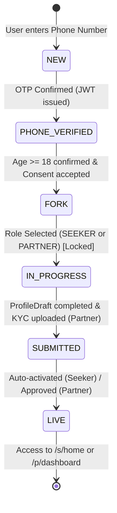

# Date to Go — Hybrid Architecture Migration Plan
**Document Version:** 1.0.0  
**Status:** Approved for Execution  
**Target:** Hybrid Platonic Companion Platform (Seeker Dating UI + Partner Marketplace Dashboard)

---

## 1. Executive Summary & Architectural Goals

The "Date to Go" platform is evolving from a traditional multi-role web portal into a **Hybrid Architecture**:
1. **Seeker Experience (`/s/*`):** A modern, fluid, dating-app style interface (Bumble/Tinder aesthetic) featuring a gesture-driven Swipe Deck, fast discovery, instant request modals, and a high-converting Soft Paywall.
2. **Partner Experience (`/p/*`):** A professional, high-density Marketplace Companion Dashboard featuring a dual-navigation system (Desktop Sidebar + Mobile Bottom Nav), quick booking management, instant completion OTP verification, and earnings wallet.
3. **Unified Trunk Onboarding:** A seamless single entry-point flow: `Welcome Screen` -> `Phone OTP Verification` -> `Age (18+) & Safety Consent` -> `Server-Locked Role Fork` ("Find a date" [Seeker] vs "Offer dates" [Partner]).
4. **Server-Driven State Machine:** The backend dictates user navigation via a deterministic `resolveNextRoute` engine. Route guards and API middlewares enforce strict 403 barriers preventing incomplete profiles from accessing core services.
5. **Draft/Published Profile Versioning:** Profile changes and onboarding steps persist in a reactive `ProfileDraft` collection before atomic publishing to the `Profile` collection upon verification/approval.
6. **Core Engine Preservation:** The fundamental business workflow remains rock-solid:  
   `Listing` -> `Request` -> `Accept` -> `Pay (Escrow Hold)` -> `Meet` -> `OTP Exchange (Seeker shares OTP with Partner)` -> `Verify OTP` -> `Release Payment to Wallet`.

---

## 2. Current Codebase Audit & Gap Analysis

### 2.1 Backend Architecture (`/backend`)
- **Current Auth (`backend/src/routes/auth.ts`, `backend/src/services/AuthService.ts`):**
  - Features traditional email/password registration alongside phone OTP verification endpoints (`/register`, `/register/otp/request`, `/login/otp/request`, `/login/otp/verify`).
  - Lacks a unified trunk onboarding state machine where onboarding progress is tracked step-by-step (`NEW` -> `PHONE_VERIFIED` -> `FORK` -> `IN_PROGRESS` -> `SUBMITTED` -> `LIVE`).
  - `/api/v1/auth/me/access` currently delegates to `AccessService.loadAccessSnapshot`, which evaluates subscriptions and legacy approval status, but lacks trunk state machine awareness (`currentStep`, `onboardingState`).
- **Current Data Models (`backend/src/models/`):**
  - `User.ts`: Contains identity fields (`email`, `phone`, `gender`, `roles`, `activeMode`, `status`, `kycStatus`). Needs explicit state fields: `onboardingState`, `currentStep`, `roleLocked`.
  - `PartnerProfile.ts`: Comprehensive partner profile containing bio, categories, photos, availability, and approval status.
  - **Missing:** Dedicated `Profile` (Published) for Seekers and unified `ProfileDraft` collection for draft/published versioning.
  - `Booking.ts`: Complete escrow state model with stages: `REQUESTED`, `ACCEPTED`, `PAYMENT_PENDING`, `PAID`, `IN_PROGRESS`, `AWAITING_OTP`, `COMPLETED`, `DECLINED`, `CANCELLED`, `EXPIRED`, `DISPUTED`, `REFUNDED`. Contains `startPin`, `otpHash`, and lockout fields.
  - **Gap in Endpoint:** Backend has `POST /bookings/:id/start-meeting` and `POST /bookings/:id/complete`, but lacks an explicit `POST /bookings/:id/verify-otp` dedicated completion endpoint as specified by the target architecture.
- **Access Control & RBAC (`@date-to-go/access-policy`):**
  - Already supports `Role.SEEKER` and `Role.PARTNER` with route matching helpers (`canAccessRoute`, `resolveHomeRoute`).
  - Must be enhanced to handle `resolveNextRoute` taking into account user onboarding stages and preventing any bypassed navigation.

### 2.2 Frontend Architecture (`/frontend`)
- **Current Routing (`frontend/src/App.tsx`):**
  - Splits `/s/*` (Seeker) and `/p/*` (Partner) guarded by `<RequireAccess>`.
  - Registration is currently a 10-field desktop-style web form (`RegisterPage.tsx`), which causes high mobile friction.
  - Trunk onboarding layout does not exist yet (`OnboardingLayout.tsx` needed).
- **Current Seeker UI (`frontend/src/roles/seeker/`):**
  - `DiscoverPage.tsx` currently renders a traditional vertical listing grid with category chips and price sliders.
  - Missing: Tinder/Bumble-style gesture-based swipe deck with Framer Motion (`framer-motion` needs to be installed in `frontend/package.json`).
  - Missing: Soft Paywall bottom sheet triggering dynamically when a seeker without an active plan clicks "Send Request".
- **Current Partner UI (`frontend/src/roles/partner/`):**
  - `PartnerDashboardPage.tsx` exists with tabbed views (Home, Requests, Listings, Wallet, Profile), but lacks a clean responsive layout with dedicated Desktop Sidebar + Mobile Bottom Nav.
  - `BecomePartnerWizard.tsx` is an isolated 8-step wizard that needs to be refactored into the new unified branch onboarding flow saving directly to `ProfileDraft`.
  - Completion OTP modal needs to be rendered as an ergonomic bottom sheet connected directly to `/bookings/:id/verify-otp`.
- **Pre-existing Code Defects Identified During Audit:**
  - `frontend/src/roles/seeker/pages/PartnerPublicProfilePage.tsx:110:9`: TypeScript error TS6133: `'renderStars' is declared but its value is never read.` (Fails `tsc --noEmit`).

---

## 3. Target State Machine & Route Policy

### 3.1 Onboarding State Machine



### 3.2 State Definitions

| State | Role Assigned? | ProfileDraft Created? | Permitted Actions | `resolveNextRoute` Destination |
| :--- | :---: | :---: | :--- | :--- |
| `NEW` | No | No | Request Phone OTP, Verify Phone OTP | `/onboarding/welcome` or `/onboarding/phone` |
| `PHONE_VERIFIED` | No | No | Age verification (18+), Accept T&C / Consent | `/onboarding/consent` |
| `FORK` | No | No | Choose "Find a date" or "Offer dates" | `/onboarding/fork` |
| `IN_PROGRESS` | Yes (Locked) | Yes | Fill dynamic branch steps, upload photos, KYC (partner) | `/onboarding/seeker` or `/onboarding/partner` |
| `SUBMITTED` | Yes | Yes (Awaiting Publish) | View review status, update KYC if requested | `/p/status` (Partner) or auto-promoted to `LIVE` (Seeker) |
| `LIVE` | Yes | Published (`Profile`) | Full dashboard access, browsing, booking, listings | `/s/home` (Seeker) or `/p/dashboard` (Partner) |

### 3.3 Server-Side RBAC Enforcement
- Any request by an uncompleted profile (`NEW`, `PHONE_VERIFIED`, `FORK`, `IN_PROGRESS`) to core endpoints:
  - `GET /api/v1/discover/*` -> **403 Forbidden** `{ code: 'ONBOARDING_INCOMPLETE', nextRoute }`
  - `POST /api/v1/bookings/*` -> **403 Forbidden** `{ code: 'ONBOARDING_INCOMPLETE', nextRoute }`
  - `GET /api/v1/partner/listings/*` -> **403 Forbidden** `{ code: 'ONBOARDING_INCOMPLETE', nextRoute }`
  - `POST /api/v1/partner/listings/*` -> **403 Forbidden** `{ code: 'ONBOARDING_INCOMPLETE', nextRoute }`

---

## 4. Database Models & Schema Migration

### 4.1 `User` Model Updates (`backend/src/models/User.ts`)
Add onboarding state and step tracking:
```typescript
onboardingState: {
  type: String,
  enum: ['NEW', 'PHONE_VERIFIED', 'FORK', 'IN_PROGRESS', 'SUBMITTED', 'LIVE'],
  default: 'NEW',
  index: true
},
currentStep: {
  type: String,
  default: 'PHONE'
},
roleForkLocked: {
  type: Boolean,
  default: false
}
```

### 4.2 `Profile` Model (Published) (`backend/src/models/Profile.ts`)
Stores active, published companion and seeker profiles for discovery and public views:
- `userId`: `ObjectId` (Ref: `User`, unique)
- `role`: `'SEEKER' | 'PARTNER'`
- `displayName`: `string`
- `gender`: `string`
- `dob`: `Date` (Age derived)
- `city`: `string`
- `area`: `string`
- `pincode`: `string`
- `location`: GeoJSON Point
- `bio`: `string`
- `interests`: `string[]`
- `hobbies`: `string[]`
- `languages`: `string[]`
- `photos`: `string[]`
- `primaryPhoto`: `string`
- **Partner Specifics:**
  - `rates`: `[{ categoryId, hourlyRatePaise }]`
  - `allowedSeekerGenders`: `string[]`
  - `smoke`: `LifestyleEnum`
  - `drink`: `LifestyleEnum`
  - `venuePreferences`: `string[]`
  - `isListed`: `boolean`
  - `ratingAvg`: `number`
  - `ratingCount`: `number`
- **Seeker Specifics:**
  - `preferredGenders`: `string[]`
  - `budgetPreference`: `number`

### 4.3 `ProfileDraft` Model (For Edits & Onboarding) (`backend/src/models/ProfileDraft.ts`)
Stores in-progress onboarding data and ongoing profile modifications:
- `userId`: `ObjectId` (Ref: `User`, unique)
- `role`: `'SEEKER' | 'PARTNER'`
- `step`: `string` (Current draft step)
- `data`: `Schema.Types.Mixed` (Flexible draft payload matching `Profile`)
- `kycDocuments`: `[{ docType, fileUrl, status, uploadedAt }]`
- `isCompleted`: `boolean`
- `version`: `number`
- `updatedAt`: `Date`

### 4.4 `Booking` Model Harmonization (`backend/src/models/Booking.ts`)
Add explicit completion OTP verification attributes and escrow status:
- Ensure `stage` enum supports: `['REQUESTED', 'ACCEPTED', 'PAYMENT_PENDING', 'PAID', 'IN_PROGRESS', 'AWAITING_OTP', 'COMPLETED', 'DECLINED', 'CANCELLED', 'EXPIRED', 'DISPUTED', 'REFUNDED']`.
- Provide helper methods for generating completion OTP and constant-time hash comparison.

---

## 5. Component & Route Mapping Matrix

| Feature / Screen | Current Path / Component | Target Path / Component | Notes |
| :--- | :--- | :--- | :--- |
| **Trunk Shell** | None | `/onboarding/*` -> `<OnboardingLayout />` | Mobile-first layout with smooth progress indicator & back buttons. |
| **Welcome / Phone** | `LoginPage.tsx` / `RegisterPage.tsx` | `/onboarding/phone` -> `<PhoneStep />` | WhatsApp / SMS OTP trigger. |
| **OTP Verification** | `VerifyPages.tsx` | `/onboarding/verify` -> `<OtpStep />` | 6-digit auto-advancing input. |
| **Age & Consent** | Partial in `RegisterPage.tsx` | `/onboarding/consent` -> `<AgeConsentStep />` | 18+ verification, safety guidelines acknowledgment. |
| **Role Fork** | None (lost intent) | `/onboarding/fork` -> `<RoleForkStep />` | Two visual cards: "Find a date" vs "Offer dates". Locks role on backend. |
| **Seeker Branch** | None (direct into app) | `/onboarding/seeker` -> `<SeekerBranchWizard />` | Name, Gender, Show Me, Interests, Photos, Location. Saves to `ProfileDraft`. |
| **Partner Branch** | `BecomePartnerWizard.tsx` | `/onboarding/partner` -> `<PartnerBranchWizard />` | Services/Rates, Location, Photos, KYC Upload, Venues. Saves to `ProfileDraft`. |
| **Seeker Dashboard** | `HomeDashboard.tsx` & `DiscoverPage.tsx` | `/s/home` & `/s/discover` -> `<SeekerDiscoverDeck />` | Swipe Deck with Framer Motion (Swipe Right = Save, Left = Skip). |
| **Request Modal** | `PartnerPublicProfilePage.tsx` | Reusable `<SendRequestModal />` | Holds listing and initiates booking request. |
| **Soft Paywall** | Redirect to `/pricing` | `<SoftPaywallSheet />` | Bottom sheet offering instant subscription plan on first request. |
| **Partner Dashboard** | `PartnerDashboardPage.tsx` | `/p/dashboard` -> `<PartnerDashboardPage />` | Dual navigation (Desktop Sidebar + Mobile Bottom Nav). |
| **Request Inbox** | Table in `PartnerDashboardPage` | `<PartnerRequestInbox />` | Accept/Decline action cards with timer indicators. |
| **Completion OTP** | Modal in `PartnerDashboardPage` | `<CompletionOtpSheet />` | Bottom sheet for partner to enter 4-digit seeker OTP -> `/bookings/:id/verify-otp`. |
| **Escrow Release** | `POST /bookings/:id/complete` | `POST /bookings/:id/verify-otp` | Atomically verifies OTP and credits partner wallet via `WalletService`. |

---

## 6. Implementation Phases Roadmap

### Phase 0: Audit & Setup (Current Phase)
- Analyze codebase, model inventory, and frontend route map.
- Generate `docs/HYBRID_MIGRATION_PLAN.md`.
- Validate zero code changes during Phase 0.

### Phase 1: Backend - State Machine & Models
- Create `Profile.ts` (Published) and `ProfileDraft.ts` (Versioning).
- Update `User.ts` with `onboardingState`, `currentStep`, `roleForkLocked`.
- Implement `/api/v1/auth/me/access` returning `{ role, currentStep, nextRoute, onboardingState }`.
- Implement `POST /api/v1/auth/fork-role` (locks `SEEKER` or `PARTNER`).
- Implement `POST /api/v1/bookings/:id/verify-otp` for completion escrow payout.
- Add strict 403 onboarding barrier middleware.

### Phase 2: Frontend - Trunk Onboarding
- Install `framer-motion` in `frontend/package.json`.
- Create `OnboardingLayout.tsx` with mobile-first container and animated step progress.
- Implement Welcome Screen, Phone Input, OTP Verification, Age/Consent, and Role Fork cards UI.
- Wire to backend endpoints and test state persistence across refreshes.

### Phase 3: Frontend - Branches & KYC
- Build `SeekerBranchWizard.tsx`: Name, Gender, Show Me, Interests, Photos, Location.
- Build `PartnerBranchWizard.tsx`: Name, Gender, Services & Rates, Photos, Integrated KYC Upload, Venues.
- Persist progress seamlessly in `ProfileDraft` via debounced autosave.
- Submit final draft to transition user to `SUBMITTED` / `LIVE`.

### Phase 4: Seeker Experience - Discover Swipe Deck
- Refactor `/s/home` & `/s/discover` into a Framer Motion gesture-driven Swipe Deck.
- Swipe Right = Save/Favorite, Swipe Left = Pass/Skip.
- Build `SendRequestModal.tsx`.
- Implement `SoftPaywallSheet.tsx` (pops up on first "Send Request" if seeker has no active subscription plan).

### Phase 5: Partner Experience & Escrow Logic
- Implement Partner Dashboard (`/p/dashboard`) with Desktop Sidebar and Mobile Bottom Nav.
- Build Request Inbox with Accept / Decline controls.
- Build the "Enter Completion OTP" bottom sheet for partners.
- Connect to `POST /api/v1/bookings/:id/verify-otp` to release funds from escrow hold to partner wallet.

### Phase 6: Real-Time & PWA Push Notifications
- Connect Socket.io / SSE for instant booking updates (`REQUESTED`, `ACCEPTED`, `PAID`, `COMPLETED`).
- Booking-bound real-time safe chat.
- Configure PWA service worker shell caching and app badging for pending requests.

### Phase 7: Hardening & UI Polish
- Zero layout shifts, Skeleton loaders across all async states.
- 44px minimum touch targets and `active:scale-95` on all tactile buttons.
- Strict TypeScript verification (`tsc --noEmit`), ESLint clean pass, and removal of all debugging console logs.

---

## 7. Architectural Risks & Mitigations

| Risk | Impact | Mitigation Strategy |
| :--- | :--- | :--- |
| **Existing Users in Database** | Existing users without `onboardingState` might be blocked from logging in. | Add a Mongoose pre-find hook or migration script to backfill existing active users to `onboardingState: 'LIVE'`. |
| **Dual Role Collision** | User wants to switch between Seeker and Partner. | Role Fork locks the primary onboarding path; dual-role switching via `/api/v1/auth/me/mode` is permitted only after both profiles are `LIVE`. |
| **Escrow Race Condition** | Both partner and auto-release worker attempt payout simultaneously. | MongoDB findOneAndUpdate with atomic stage transition `stage: 'AWAITING_OTP' -> 'COMPLETED'` ensures idempotent single payout. |
| **OTP Brute Force** | Malicious partner attempts to guess the 4-digit seeker OTP. | Enforce exponential backoff: max 5 attempts before 30-minute lockout on booking. |
| **TypeScript Compilation Errors** | Pre-existing TS error in `PartnerPublicProfilePage.tsx` (`renderStars` unused). | Fix the unused variable cleanly in Phase 1/Phase 2 without altering logic. |

---

*End of Migration Plan. Ready for Phase 1 execution upon confirmation.*
