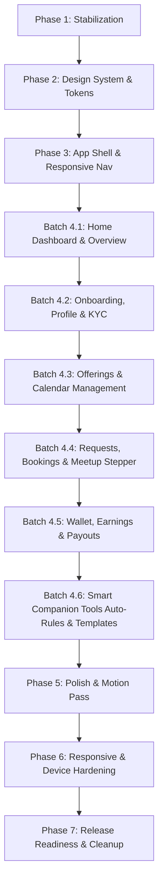

# Partner Panel UI/UX Architectural Audit & Batch Plan

*Date to Go – Platonic Companion Platform*  
*Document Version: 1.0 (Phase 0 Discovery Baseline)*

---

## 1. Executive Summary

A comprehensive, autonomous discovery of the existing Partner panel was conducted across the codebase (`frontend/src/roles/partner/`, `frontend/src/layout/`, `frontend/src/pages/`, `packages/access-policy/`, and `backend/src/routes/partner*`).

### Key Discoveries:
1. **Absence of Unified App Shell**: `<PartnerLayout />` is currently a bare `<Outlet />`. Navigation, headers, and mode-switching are duplicated or absent across partner subpages. `PartnerShell.tsx` is an orphaned dead file.
2. **Severe Mobile Bottom Nav Overflow (P0)**: In `PartnerDashboardPage.tsx`, the mobile bottom navigation bar renders **8 tabs** horizontally (`Home`, `Requests`, `Accepted`, `Listings`, `Auto-Rules`, `Quick Replies`, `Wallet`, `Settings`), totaling 512px minimum width. On typical phones (360px–390px), this causes severe horizontal squishing, unreadable clipped text, and broken tap targets.
3. **Anti-Patterns & UX Deficiencies**:
   - Multiple raw browser native alerts and confirms (`window.confirm()`, `alert()`) in `KycPage.tsx`, `PartnerBookingDetailsPage.tsx`, `QuickRepliesManager.tsx`, and `BulkListingsBar.tsx`.
   - Hardcoded inline JavaScript styles with fixed hex colors in `AvailabilityBuffersCard.tsx` that completely fail in dark mode.
   - Generic spinners on every page causing noticeable layout shifts (CLS) rather than content-matching shimmer skeletons.
4. **Code Health & Dependencies**:
   - `tsc --noEmit` is clean (0 errors).
   - ESLint v9 configuration file is missing in `frontend/`, causing `npm run lint` to fail out of the box.
   - Bundle size is healthy: initial partner JS is ~110 KB gzipped, well under the 250 KB budget.

---

## 2. Viewport Matrix Audit (Baseline Observations)

| Viewport (W x H) | Device Class | Critical Observations & Findings | Status |
|------------------|--------------|-----------------------------------|--------|
| **320 x 568** | Small Phone (SE 1st gen) | • Bottom nav overflows completely (512px on 320px). • Metric cards in dashboard clip currency digits. • Floating bulk action bar collides with bottom nav. | **CRITICAL DEFECT** |
| **360 x 740** | Android Standard | • Bottom nav items overlap and squish. • Tap targets under 44px due to crowding. • Fixed action bar overlaps bottom content. | **CRITICAL DEFECT** |
| **390 x 844** | Modern iPhone | • Bottom nav tabs truncated. • Missing safe area insets on older iOS home bar. • Health ring missing animated gradient. | **DEFECT** |
| **430 x 932** | Large Phone (Pro Max) | • Bottom nav readable but crowded. • Form inputs stretch full width without comfortable max-width. | **NEEDS UPGRADE** |
| **600 x 960** | Small Tablet / Foldable | • Sidebar hidden; layout uses mobile layout stretched wide without utilizing extra screen width. | **NEEDS UPGRADE** |
| **768 x 1024** | iPad Portrait | • Sidebar snaps in at 260px; content column becomes narrow. • Missing collapsible navigation rail (72px). | **NEEDS UPGRADE** |
| **820 x 1180** | iPad Air | • Content cards stretch into wide single-column rows. | **NEEDS UPGRADE** |
| **1024 x 768** | iPad Landscape | • Sidebar active, but requests and bookings lack 2-pane master-detail view. | **NEEDS UPGRADE** |
| **1280 x 800** | Small Desktop / Laptop | • Excessive empty whitespace in forms and modals. • Requests require full-page navigation instead of split pane. | **NEEDS UPGRADE** |
| **1440 x 900** | Desktop Standard | • Content centered with max-w-6xl; clean but lacks high-density command palette and quick filters. | **NEEDS UPGRADE** |
| **1920 x 1080** | Large Desktop (FHD) | • Excessive whitespace; tables and cards do not leverage full desktop canvas. | **NEEDS UPGRADE** |
| **844 x 390** | Landscape Phone | • Fixed top header (h-16) and bottom nav consume over 60% of vertical screen height, leaving tiny scrollable area. | **DEFECT** |
| **200% Zoom @ 1280** | A11y Low-Vision Zoom | • Header elements collide with mode-switch button; text wraps awkwardly. | **DEFECT** |

---

## 3. Prioritized Defect Catalog

### P0 – Blockers
1. **DEF-01: Mobile Bottom Nav Horizontal Overflow**:
   - *File*: `frontend/src/roles/partner/pages/PartnerDashboardPage.tsx` (Lines 818–842)
   - *Issue*: 8 navigation tabs rendered horizontally without responsive collapsing, exceeding screen width by over 150px on standard phones.
   - *Fix*: Implement clean 4-tab frosted bottom nav (`Home`, `Requests`, `Listings`, `More`), moving secondary tools (`Auto-Rules`, `Templates`, `Buffers`, `Wallet`) into a dedicated "More / Tools" sheet or profile sub-nav.
2. **DEF-02: Missing Unified Partner Shell**:
   - *File*: `frontend/src/layout/PartnerLayout.tsx`
   - *Issue*: Partner subpages (`/p/booking/:id`, `/p/listings/:id`, `/p/kyc`, `/p/profile`, `/p/onboarding`) are detached from the dashboard shell, lacking persistent navigation, consistent headers, and breadcrumbs.
   - *Fix*: Create unified `PartnerShell` in Phase 3 behind feature flag `partner.ui.v3.shell`.
3. **DEF-03: ESLint Configuration Failure**:
   - *File*: `frontend/`
   - *Issue*: ESLint v9 cannot find flat config (`eslint.config.js`), failing CI lint checks.
   - *Fix*: Add compatible `eslint.config.js` in Phase 1 stabilization.

### P1 – Critical Anti-Patterns & Accessibility
4. **DEF-04: Native Browser Dialogs (`window.confirm` & `alert`)**:
   - *Files*: `KycPage.tsx`, `PartnerBookingDetailsPage.tsx`, `QuickRepliesManager.tsx`, `BulkListingsBar.tsx`
   - *Issue*: Breaks mobile UX, un-themed, blocks JS execution thread.
   - *Fix*: Replace with reusable animated `ConfirmDialog` and `Toast` components from the design system.
5. **DEF-05: Inline Styles & Dark Theme Breakage**:
   - *File*: `AvailabilityBuffersCard.tsx` (Lines 44–147)
   - *Issue*: Hardcoded JavaScript inline styles with fixed hex colors (`#ffffff`, `#1E293B`, `#FEE2E2`) rendering bright white boxes in dark mode.
   - *Fix*: Refactor completely to Tailwind CSS semantic color tokens.
6. **DEF-06: Layout Shift (CLS) on Data Loading**:
   - *Files*: `PartnerDashboardPage.tsx`, `PartnerProfilePage.tsx`, `PartnerBookingDetailsPage.tsx`, `PartnerListingDetailsPage.tsx`
   - *Issue*: Fullscreen spinning circles instead of layout-matching skeleton shimmers.
   - *Fix*: Introduce modular skeleton components (`StatCardSkeleton`, `BookingCardSkeleton`, `ProfileHeaderSkeleton`).
7. **DEF-07: Unaccessible Icon Buttons & Color Contrast Failures**:
   - *Files*: `PartnerDashboardPage.tsx`, `KycPage.tsx`, `BookingChatPage.tsx`
   - *Issue*: Icon-only buttons lack `aria-label`; amber status chips have contrast ratio below 4.5:1.
   - *Fix*: Add `aria-label` to all interactive icons; adjust status badge text tokens to WCAG AA.

### P2 – Major UI/UX & Dating-App Quality Upgrades
8. **DEF-08: Lack of Photo-Forward Visuals**:
   - *Files*: `PartnerDashboardPage.tsx`, `PartnerProfilePage.tsx`, `PartnerRequestInbox.tsx`
   - *Issue*: Avatars are flat single-color circles with first-letter text; missing soft gradient borders, verification badges, blur-up placeholders, and 3:4 portrait ratios.
   - *Fix*: Introduce `AvatarWithBadge` and photo-forward card templates.
9. **DEF-09: Missing Tablet Rail & Desktop Master-Detail View**:
   - *Files*: `PartnerDashboardPage.tsx`, `PartnerRequestInbox.tsx`, `PartnerBookingDetailsPage.tsx`
   - *Issue*: Tablet displays cramped 260px sidebar; desktop requires navigating to separate pages for booking details rather than leveraging split-pane master-detail.
   - *Fix*: Implement 72px tablet rail and responsive two-pane layout for Requests/Bookings on screens >= 1024px.
10. **DEF-10: 100% Hardcoded English Strings (Rule R8 Violation)**:
    - *Files*: All partner pages and components.
    - *Issue*: Strings are hardcoded directly in JSX; `frontend/src/shared/i18n.ts` is not consumed.
    - *Fix*: Wire all user-facing strings through `t()` with complete English (`en`) and Hindi (`hi`) translations.

### P3 – Minor Code Health & Cleanups
11. **DEF-11: Dead Code / Unused Shell**:
    - *File*: `frontend/src/components/layout/PartnerShell.tsx`
    - *Issue*: Dead unused file.
    - *Fix*: Clean up in Phase 7.
12. **DEF-12: Leftover `console.log` Statements**:
    - *File*: `PartnerDashboardPage.tsx` (Lines 85–86)
    - *Issue*: Debug logs leaking to production console.
    - *Fix*: Remove in Phase 1.
13. **DEF-13: Excessive `any` Types**:
    - *Files*: `PartnerDashboardPage.tsx`, `BecomePartnerWizard.tsx`, `PartnerProfilePage.tsx`
    - *Issue*: Untyped state variables (`profile`, `health`, `stats`, `bookings`).
    - *Fix*: Introduce strict TypeScript interfaces (`IPartnerProfile`, `IPartnerStats`, `IBookingItem`).

---

## 4. Proposed Batch Plan for Phase 4.N

Following Rule R1 and the design specification, the redesign work will be executed in the following structured batches:

* **Batch 4.1 – Home Dashboard & Overview**:
  - `PartnerDashboardPage.tsx` (Home tab)
  - Profile health score ring, active bookings carousel, quick stats, celebratory welcome, responsive cards.
* **Batch 4.2 – Onboarding, Profile & KYC**:
  - `BecomePartnerWizard.tsx` (`/p/onboarding`)
  - `KycPage.tsx` (`/p/kyc`, `/p/status`)
  - `PartnerProfilePage.tsx` (`/p/profile`)
  - Photo upload with 3:4 aspect ratio, live preview, verified badge ring, animated step indicator.
* **Batch 4.3 – Offerings & Calendar Management**:
  - `CreateListingSheet.tsx`
  - `PartnerListingDetailsPage.tsx` (`/p/listings/:id`)
  - `BulkListingsBar.tsx`
  - Active listings cards, share sheets, status toggle, price modifiers.
* **Batch 4.4 – Requests, Bookings & Meetup Stepper**:
  - `PartnerRequestInbox.tsx` (Requests & Accepted tabs)
  - `PartnerBookingDetailsPage.tsx` (`/p/booking/:id`)
  - `PartnerOtpSheet.tsx` (Auto-advancing 4-digit PIN check-in)
  - 2-pane master-detail view on desktop, in-person meetup status flow, emergency SOS.
* **Batch 4.5 – Wallet, Earnings & Payouts**:
  - `PartnerDashboardPage.tsx` (Wallet tab)
  - `WithdrawModal.tsx`
  - High-contrast wallet card with glassmorphism gradient, instant UPI / Bank NEFT withdraw, UTR tracking.
* **Batch 4.6 – Smart Companion Tools**:
  - `AutoRulesManager.tsx` & visual simulator stepper
  - `QuickRepliesManager.tsx` with keyboard shortcuts
  - `AvailabilityBuffersCard.tsx` (Tailwind conversion & dark mode support)
